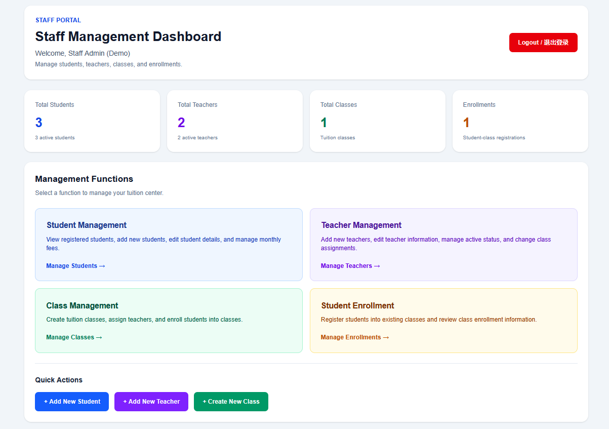
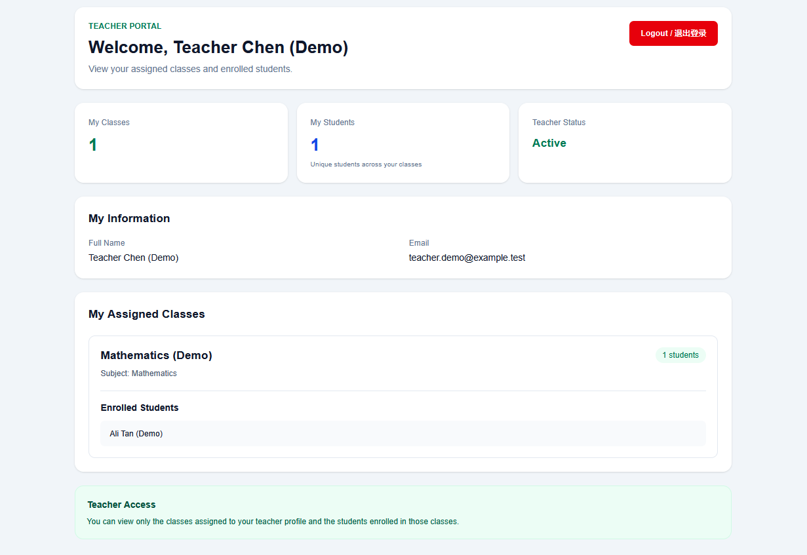
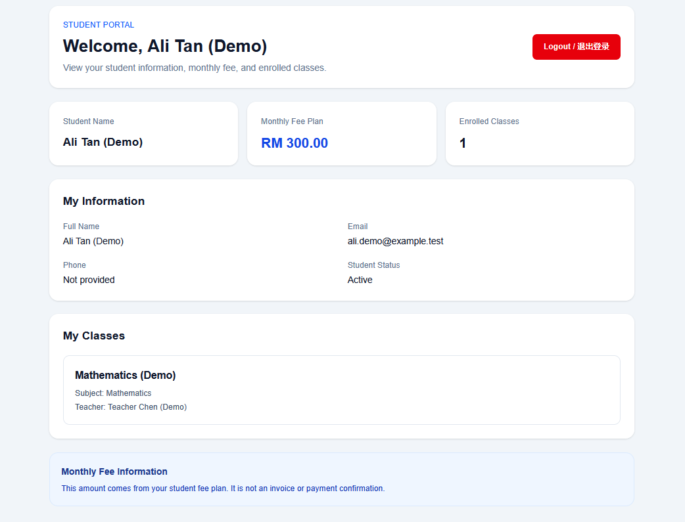

# Tuition Management System V2

A full-stack tuition center management system built with Next.js, TypeScript, Prisma ORM, PostgreSQL, and Better Auth. The application provides role-based dashboards for staff, teachers, and students to manage tuition center operations.

## Screenshots

### Staff Management Dashboard

Staff can manage students, teachers, tuition classes, and student enrollments.



### Teacher Dashboard

Teachers can view their assigned classes, enrolled students, and teacher profile information.



### Student Dashboard

Students can view their personal information, monthly fee plan, and enrolled classes.



## Features

### Authentication and Authorization
- Email and password authentication with Better Auth.
- Role-based access for Staff, Teachers, and Students.
- Protected dashboards and server-side role checks.
- Login and logout functionality.

### Student Management
- View registered students.
- Create and edit student records.
- Manage student status and monthly fee plans.

### Teacher Management
- Create and edit teacher profiles.
- Manage teacher active status.
- Assign and reassign teachers to tuition classes.

### Class Management
- Create tuition classes.
- Assign teachers to classes.
- Enroll students into classes.
- View class and enrollment information.

### Role-Based Dashboards
- **Staff:** Overview of students, teachers, classes, and enrollments.
- **Teacher:** View assigned classes and enrolled students.
- **Student:** View personal information, monthly fee plan, and enrolled classes.

## Tech Stack

| Technology | Purpose |
|---|---|
| Next.js App Router | Full-stack web application |
| TypeScript | Type-safe application code |
| Tailwind CSS | User interface styling |
| Better Auth | Authentication |
| Prisma ORM | Database access and data modeling |
| PostgreSQL | Relational database |
| Git and GitHub | Version control and source code management |

## Project Structure

```text
tuition-management-system/
├── prisma/
│   ├── migrations/
│   └── schema.prisma
├── scripts/
│   └── create-demo-logins.ts
├── src/
│   ├── app/
│   │   ├── api/auth/
│   │   ├── dashboard/
│   │   ├── login/
│   │   ├── staff/
│   │   ├── teacher/
│   │   └── student/
│   ├── components/
│   └── lib/
│       ├── auth.ts
│       ├── auth-client.ts
│       ├── prisma.ts
│       └── role-guard.ts
├── docs/
│   └── screenshots/
├── prisma7.config.ts
├── package.json
└── README.md
```

## Getting Started

### Prerequisites

Before running the project, make sure you have installed:

- Node.js (version supported by the project's Next.js version)
- npm
- PostgreSQL
- Git

### 1. Clone the repository

```bash
git clone https://github.com/weizhe0/Tuition-Management-System.git
cd Tuition-Management-System
```

You need access to the repository if it is private.

### 2. Install dependencies

```bash
npm install
```

### 3. Configure environment variables

Create a local `.env` file in the project root and configure the database connection and authentication settings required by the project.

Typical variable names include:

```dotenv
DATABASE_URL="your-local-postgresql-connection-string"
SHADOW_DATABASE_URL="your-local-shadow-database-connection-string"
BETTER_AUTH_URL="http://localhost:3000"
BETTER_AUTH_SECRET="your-own-long-random-secret"
```

Use the exact variable names expected by `prisma7.config.ts` and `src/lib/auth.ts`. Replace the example values with your own local configuration.

**Never commit your real `.env` file, database passwords, or authentication secrets to GitHub.**

### 4. Set up the database

After configuring PostgreSQL and the environment variables, apply the project's Prisma migrations:

```bash
npx prisma migrate dev
npx prisma generate
```

Run these commands only after confirming that your database connection points to the intended local development database.

### 5. Start the development server

```bash
npm run dev
```

Open [http://localhost:3000](http://localhost:3000) in your browser.

## Development Notes

- This project currently uses fictional demo data for development and demonstration.
- Demo account creation is handled by a development script in `scripts/create-demo-logins.ts`.
- A fresh installation requires its own environment variables and PostgreSQL database.
- Before production use, review security, account lifecycle management, database backups, automated testing, and deployment configuration.

## Future Improvements

- Attendance management
- Payment and outstanding fee tracking
- Class timetable and scheduling
- Staff-managed teacher and student accounts
- Automated testing with Vitest and Playwright
- Production deployment and database backup procedures

## Author

Developed as a hands-on project to practise full-stack development, relational database design, authentication, role-based authorization, and Git version control.